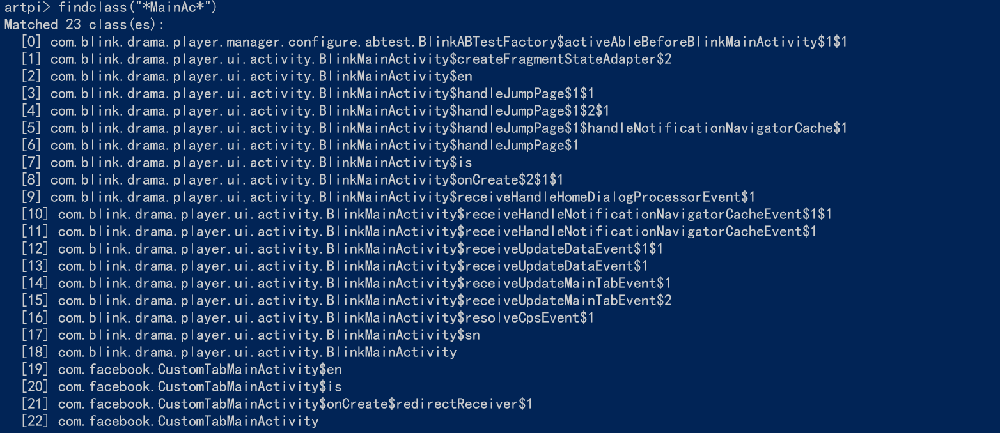
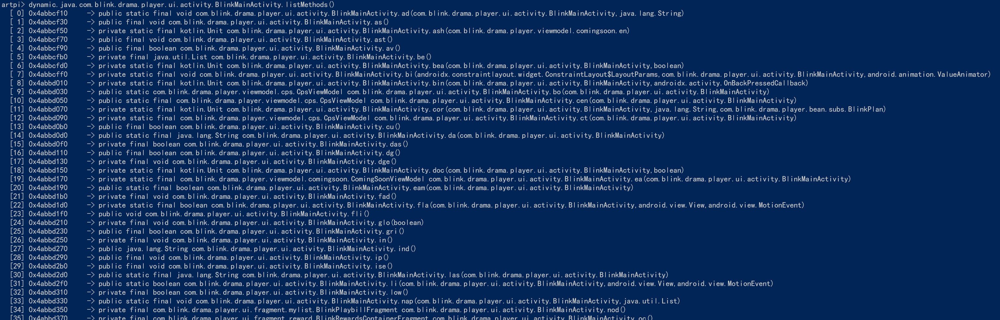
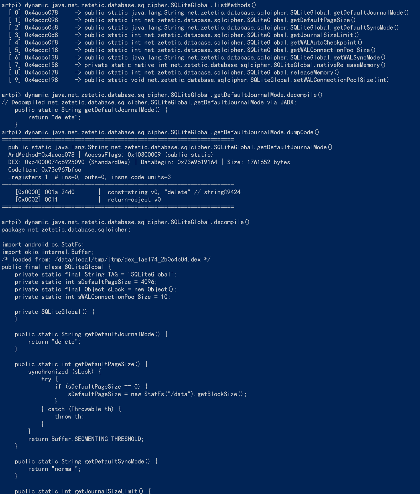
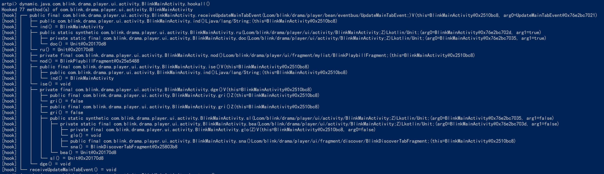
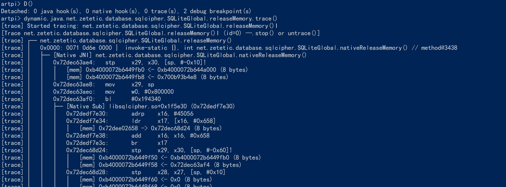
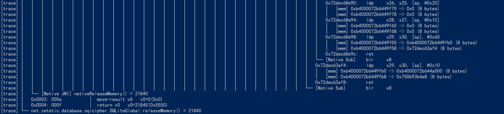
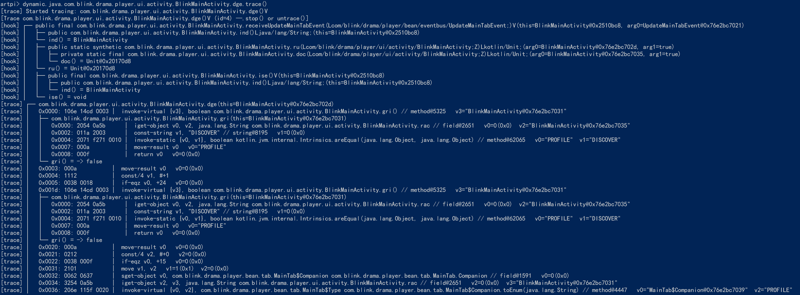
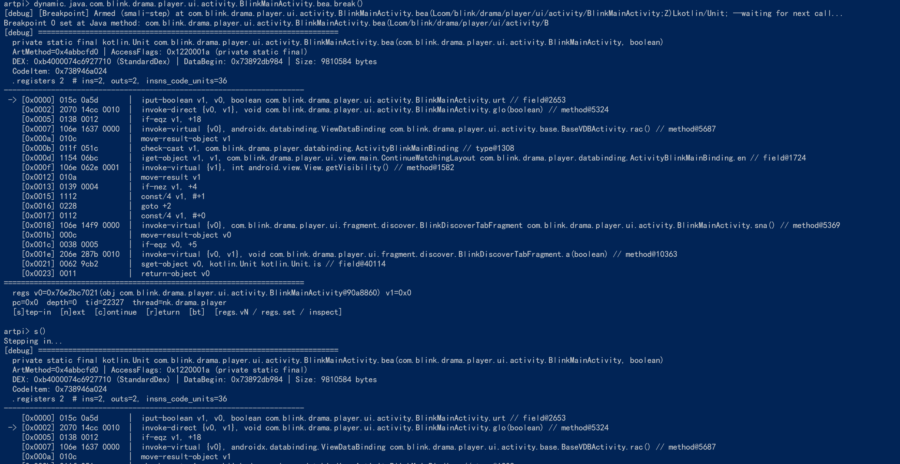
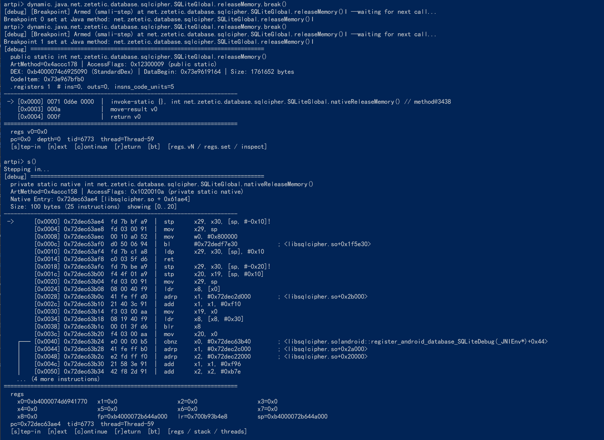
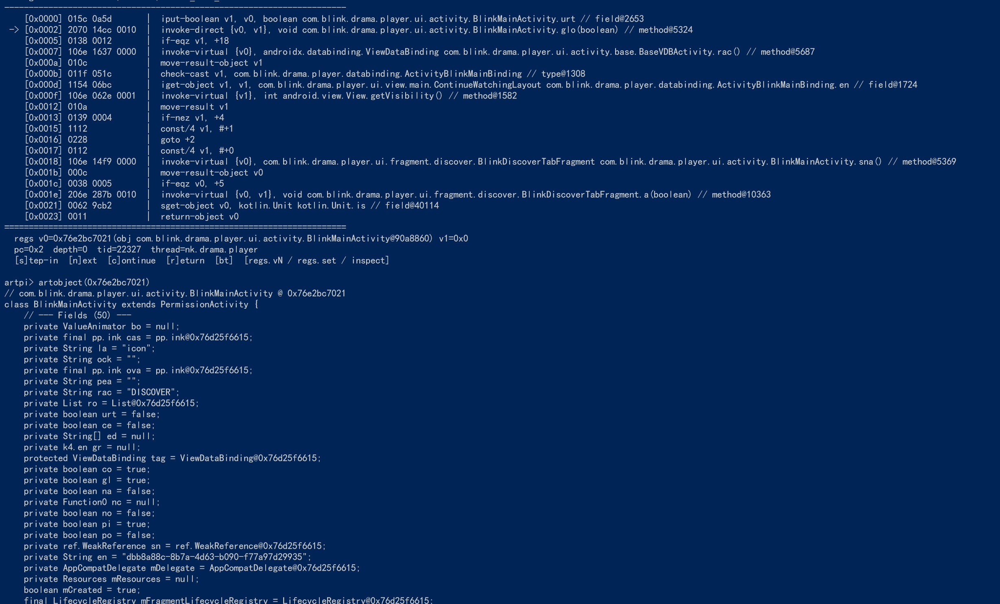

# ArtPI (ART Process Instrumentation)

[中文](README.md) | [English](README_EN.md)

> 面向 Android ART 运行时的**高性能原生动态插桩与逆向分析工具包**。  
> 支持 Java 方法 Hook、Smali 反汇编与**运行时 JADX 单类/单方法免 OOM Java 反编译**、堆内存实例枚举（`choose`）、Dalvik 字节码解释沙箱（单步 / StepIn / Mock）、Java↔Native 全栈混合追踪，并通过 **ptrace (亦可扩展其它注入方案) 一键注入 + 多 Payload 链式内嵌 + 内置 QuickJS REPL** 实现终端交互与脚本自动化。

适用平台：**Android 7.0 ~ 15（arm64-v8a）**，进程注入需 root。

### 测试验证基准设备 (Test Platform)

| 属性 | 参数 / 说明 |
|---|---|
| **设备型号 (Model)** | Google Pixel 6 (`oriole`) |
| **操作系统 (OS)** | Android 13 (Tiramisu, API Level 33) |
| **系统构建号 (Build ID)** | `TP1A.220624.021` |
| **Linux 内核 (Kernel)** | `5.10.107-android13-4-00005-ge05ae1680b1c-ab8715050` |
| **Root 环境** | APatch (Kernel Patch, SuperUser v11039) / Magisk |

---

## 1. 核心能力

| 能力 | 说明 |
|---|---|
| **Java 方法 Hook** | `PI::resolve(...).hook(cb)`，`frame[0]` 读写参数、`setResult` 篡改返回值、`invokeOriginal` 调用原方法；支持类级 `hookall` |
| **高阶 Java 反编译** | 基于单 DEX 内存快速导出与内嵌 JADX CLI，实现秒级**免 OOM 单类与单方法高阶 Java 源码反编译**（`.disassembly()` / `.decompile()`） |
| **Smali 反汇编** | 运行时直接从内存 `CodeItem`（StandardDex / CompactDex）极速 dump 规范 Smali 指令流与寄存器状态 |
| **堆实例扫描 (`choose`)** | 类似 Frida `Java.choose`，支持纯 Native GC 物理扫描与 JVMTI 极速遍历双模式，实时捕获并操作存活对象 |
| **字节码解释沙箱** | 内嵌 nmmvm 解释器重放方法体，支持指令级单步、`StepIn` 递归解释、`Mock` 返回值打桩、异常拦截 |
| **全栈混合追踪** | Java 解释执行遇到 JNI 方法自动交接给 QBDI/Gum，Native 执行完无缝切回，输出连贯的跨层树形调用栈 |
| **双轨 JNI 追踪** | 支持零内存修改的硬件断点追踪 (`jnihw`) 与极速全局 Vtable 虚表劫持 (`jnitrace`)，单行紧凑输出调用参数、真实返回值、耗时与 caller 模块偏移，自动反解 `RegisterNatives` 动态注册方法 |
| **动态对象反射链** | `artobject(addr)` 持久化提升全局引用，支持链式属性读写、方法调用与 REPL Tab 实时补全 |
| **界面自动化 (`UI.*`)** | `UI.dump` 打印 View 层级树，`UI.find` 附带祖先链与最近点击目标，`UI.click` / `swipe` / `setText` 免 ADB 直接操作界面 |
| **ptrace 链式内嵌注入** | 单个 `artpi-cli` 二进制**联合内嵌 Agent SO 与 JADX CLI Jar**，自动解压部署，支持 `-P <pid>` / `-k <pkg>` / `-f <file>` |
| **硬件断点/观察点** | 现代统一 API（`HW.attach` 代码断点 / `HW.watch` 数据断点 / `HW.watchDlopen` 动态库监控），ARM64 物理调试寄存器驱动，零内存修改、无检测特征、跨线程布控与硬件单步连续触发 |
| **Unity IL2CPP 分析** | 基于 UnityResolve 的 `dynamic.unity`：程序集/类/字段/方法遍历与调用、通配符 `findclass` / `findmethods`、MethodInfo 断点与 Hook、GameObject / Button 监听器解析、`libil2cpp.so` 导出符号直达 |
| **内置 QuickJS REPL** | 注入后直接进入交互终端，支持可注册代理域 `dynamic.java` / `dynamic.native` / `dynamic.unity`（`objc` 按运行时条件挂载），免重编动态分析 |

---

## 2. 架构总览

```text
┌────────────────────────────────────────────────────────────────────────┐
│ 宿主交互层 (Host / adb shell 终端)                                      │
│ 支持交互式 REPL、单行 -e 求值、脚本文件执行 -f <script.js>                   │
└───────────────────────────────────┬────────────────────────────────────┘
                                    │ 多 Payload 链式打包 (自包含)
┌───────────────────────────────────▼────────────────────────────────────┐
│ artpi-cli (arm64 root 可执行文件)                                       │
│   [注入器 ELF][libartpi_agent.so][PPAYLOAD][jadxcli.jar][PJADXJAR]     │
│   • 启动时自解压释放 jadxcli.jar 到 /data/local/tmp (0666)             │
│   • 部署 so 到 App lib 目录 → ptrace 远程 __loader_android_dlopen_ext  │
└───────────────────────────────────┬────────────────────────────────────┘
                                    │ 注入到目标 App 进程
┌───────────────────────────────────▼────────────────────────────────────┐
│ libartpi_agent.so  (链接 libartpi_static.a + QuickJS + 通信层)          │
│   PI::init → QuickJS 运行时 → TCP Agent Server (20700..20800)          │
│   • dynamic.java / dynamic.native 动态链式调用代理                      │
│   • 内存 DEX 单文件导出 + dalvikvm 隔离调用 JADX 反编译                 │
└───────────────────────────────────┬────────────────────────────────────┘
                                    │
┌───────────────────────────────────▼────────────────────────────────────┐
│ libartpi_static.a  (底层能力库)                                          │
│  ├─ engine/pine       Pine Hook 底座 (跳板 / ArtMethod 劫持)            │
│  ├─ engine/art        ART 结构体与全版本动态偏移探测                      │
│  ├─ engine/trampoline arm64 / thumb2 / x86 原生汇编跳板                │
│  ├─ engine/nmmvm      内嵌 Dalvik 字节码解释器                          │
│  ├─ engine/native     Frida-Gum Inline Hook + QBDI DBI 执行器         │
│  ├─ engine/tracer     Java↔Native 跨层统一追踪桥                        │
│  ├─ engine/utils      内存保护 / ELF 解析 / WellKnownClasses            │
│  ├─ src/core          PI::init / resolve / Method / HookHandle / Heap  │
│  ├─ src/dex           StandardDex / CompactDex 解析 + Smali 反汇编    │
│  └─ src/sandbox       CodeItem 提取 / 解释执行器 / 沙箱回调层             │
└────────────────────────────────────────────────────────────────────────┘
```

---

## 3. 目录结构

```text
impl_glm/
├── include/ArtPI.h              # 对外统一门面头文件 (PI::resolve / CallFrame / Native)
├── src/
│   ├── core/                    # 框架主入口、Method 包装、HookHandle、Logger、Heap 扫描
│   ├── dex/                     # DEX 解析与运行时 Smali 反汇编
│   ├── sandbox/                 # 解释沙箱：CodeProvider / Executor / Tracer 回调
│   └── agent/                   # 注入后的 Agent：QuickJS 运行时 + TCP/MessagePack Server + dynamic 代理
├── engine/
│   ├── art/ pine/ trampoline/   # ART 模型、Pine Hook 底座、原生跳板
│   ├── nmmvm/                   # 内嵌 Dalvik 字节码解释器
│   ├── native/                  # Frida-Gum Hooker / QBDI DBI 引擎
│   ├── tracer/unified/          # Java↔Native 统一追踪桥
│   ├── qjs/quickjs/             # QuickJS 引擎源码
│   ├── mpack/mpack.h            # 轻量 MessagePack 编解码 (单头文件)
│   └── utils/                   # 内存、ELF、符号工具类
├── cli/
│   ├── injector/                # artpi-cli：ptrace 注入器 + 多 Payload 打包 + REPL 客户端
│   ├── jadxcli.jar              # 反编译引擎（内嵌到 artpi-cli 中，运行时自动释放）
│   └── artpi_repl.py            # Python 宿主端 REPL 客户端
├── external/                    # xdl (linker 绕过) / xz-embedded / frida-gum / qbdi
├── assets/                      # 静态展示资源
│   └── screenshots/             # 实机交互运行效果截图
└── prebuild/                    # 构建产物 (libartpi.so / libartpi_static.a / libartpi_agent.so / artpi-cli)
```

---

## 4. 快速开始

工程自带 Gradle Wrapper，完全跨平台（Windows / Linux / macOS 同一套命令），零外部环境依赖。

### 4.1 构建命令

```bash
# 产品（核心库 + Agent + 联合内嵌注入器）
./gradlew build                  # = buildNative（构建完整产品线）
./gradlew buildNative            # 三库一端：core / agent / cli
./gradlew libartpi               # 仅核心库
./gradlew :agent:build           # 仅 Agent SO
./gradlew :cli:build             # 仅 CLI（编译注入器并自动联合打包 agent.so + jadxcli.jar）

# 测试套件（按需独立运行）
./gradlew :test:buildTest         # Suite 1 (ArtPI.h 原生 API 测试)
./gradlew :test-js:buildTest      # Suite 2 (QuickJS 绑定测试)
./gradlew :test-harness:buildTest # Playground 演练场

./gradlew cleanNative            # 清理 build/ 与 prebuild/
```

> **环境要求**：已配置 `ANDROID_HOME` / `ANDROID_SDK_ROOT` 或 `NDK_HOME`，也可在同级 `local.properties` 中指定 `sdk.dir=` 与 `ndk.dir=`。构建工具链（`cmake`/`ninja`/`javac`/`d8`/`adb`）由 Gradle 自动索引。

产物分布（均在 `prebuild/`）：

| 产物 | 路径 | 包含内容 |
|---|---|---|
| 单文件 CLI | `prebuild/bin/arm64-v8a/artpi-cli` | 注入器本体 + 内嵌 `libartpi_agent.so` + 内嵌 `jadxcli.jar` |
| Agent 动态库 | `prebuild/lib/arm64-v8a/libartpi_agent.so` | 运行时交互引擎，由 CLI 注入到目标进程 |
| 基础静态库 | `prebuild/lib/arm64-v8a/libartpi_static.a` | 独立嵌入开发用的基础底层静态库 |
| 底层动态库 | `prebuild/lib/arm64-v8a/libartpi.so` | C++ 对外动态库 |
| 头文件 | `prebuild/include/ArtPI.h` | 统一门面 API |

---

### 4.2 部署与运行
(注意：代码补全功能需要在adb shell中再执行 ./artpi-cli xxx 才能生效 如果使用 adb shell su -c xxx 这种方式启动无法体验代码补全)

```bash
# 1. 部署：仅需推送单个 artpi-cli 到设备 /data/local/tmp（自动授予 755）
./gradlew deploy

# 2. 注入目标应用并进入交互式 REPL
adb shell su -c "/data/local/tmp/artpi-cli -k com.example.app"

# 3. 或者以脚本模式执行单个 JS 脚本文件并退出
adb push my_script.js /data/local/tmp/my_script.js
adb shell su -c "/data/local/tmp/artpi-cli -k com.example.app -f /data/local/tmp/my_script.js"

# 4. 或者在命令行直接对表达式求值
adb shell su -c "/data/local/tmp/artpi-cli -k com.example.app -e 'findclass(\"*Activity\");'"

# 5. Spawn 启动并在早期监控动态库加载（硬件断点零内存补丁，实时记录所有 dlopen）
adb shell su -c "/data/local/tmp/artpi-cli -S com.example.app --lib-log"

# 6. Spawn 启动并在目标 SO 库加载时自动挂起主线程（便于下断点分析，在 REPL 中输入 resume 继续运行）
adb shell su -c "/data/local/tmp/artpi-cli -S com.example.app --stop-lib libnative.so"
```

> **连接复用**：`artpi-cli` 自动扫描 `20700..20800` 端口并对已注入 Agent 探活复用；若应用未被注入，会自动提取 payload 完成远程 ptrace 注入。若应用未声明 `INTERNET` 权限，自动降级为抽象 UNIX Domain Socket（`@artpi_agent_<pid>`）。

---

## 5. 实机交互演示 (Showcase)

ArtPI 注入目标进程后，通过终端进入内置 QuickJS REPL 即可获得交互式动态逆向体验：

### 5.1 类检索与模糊匹配 (`findclass`)
支持通配符与正则模式，秒级枚举当前运行时中所有已加载的类并输出唯一句柄：


### 5.2 类声明方法与签名列举 (`listMethods`)
快速列出目标类的所有声明方法、访问标志位（`public/private/static/final` 等）及底层 `ArtMethod*` 指针：



### 5.3 一键批量 Hook 拦截 (`hookall`)
无需繁琐编写单个钩子，一键完成整类非抽象/原生方法批量插桩，自动格式化打印被调对象、参数实参及返回结果：


### 5.4 跨层树形调用链路追踪 (`Trace.unified` / `trace`)
全栈贯通 Java 解释执行与 Native C/C++ 机器码，遇到 JNI 边界自动交接，输出连贯的跨层调用链路树：
- **跨层追踪启动与跨边界交接**：

- **跨层完整链路执行树**：

- **单方法细粒度追踪**：


### 5.5 断点拦截与单步调试 (`break`)
在关键方法处下断点拦截执行，支持单步步入/步过（`s`/`n`/`c`）与实时寄存器状态打印（`regs`）：


### 5.6 Java $\to$ Native 跨层单步穿透
单步调试支持无缝穿透 JNI 边界深入底层 Native 机器码，同步观察 ARM64 寄存器状态与反汇编指令：


### 5.7 活体对象反射持久化 (`artobject`)
获取堆内实例后直接提升为持久化全局引用，支持交互式反射调用成员方法与属性读写：


---

## 6. JavaScript 运行时 API 手册

### 6.1 动态代理链 (`dynamic.*`) — 首选交互方式

`dynamic` 提供类似属性树的直观链式调用，支持点号智能路由（包名、类名、内部类、方法名全自动解析）。

#### 1. Java 类与方法代理 (`dynamic.java.*`)

```javascript
// 1. 获取类包装对象 (ClassBox)
let Act = dynamic.java.com.blink.drama.player.ui.activity.download.BlinkDownloadManageActivity;

// 类级操作
Act.dumpCode();           // 遍历 dump 该类所有声明方法的汇编代码
Act.dumpSmali();          // 遍历 dump 该类所有声明方法的 Smali 助记符
Act.listMethods();        // 列出所有声明方法信息及 ArtMethod* 指针
Act.findMethods("on*");   // 模糊查找类内方法
Act.hookall(cb?);         // 一键 Hook 该类全部非 abstract/native 方法

// 类级反编译：输出整类的完整 Java 源码（免 OOM 极速反编译）
console.log(Act.disassembly());  // 或 Act.decompile()

// 堆实例扫描：搜索当前进程堆中所有该类的活体对象
Act.choose({
    onMatch: function(instance) {
        console.log("Found instance: " + instance);
    },
    onComplete: function(total) {
        console.log("Total found: " + total);
    }
});

// 2. 访问类成员方法 (MethodBox)
let oc = Act.onCreate;

// 方法级反编译：精准抽取该方法的 Java 源码块（包含注解与实现体）
console.log(oc.disassembly());    // 或 oc.decompile()

// 方法级 Smali / 原生反汇编
console.log(oc.dumpSmali());      // dump 该方法的 Smali 字节码
console.log(oc.dumpCode());       // 自动识别 Java/Native 并 dump 代码

// 安装 Hook（支持无参默认日志、单回调、onEnter + onLeave 双回调三种形式）
oc.hook();                        // 1) 无参：自动树形打印入参与返回值
oc.hook(function(o) {             // 2) 单回调：入口触发，调用 o.setResult(...) 可直接跳过原方法
    console.log("onCreate called! this=" + o.thiz + "\n" + o.stack);
    // o.args[0] = ...;           // 直接修改数组元素即可篡改入参
    // o.setResult(...);          // 篡改返回值并跳过原方法执行
});
oc.hook(                          // 3) 双回调：原方法必定在 onEnter 与 onLeave 之间执行
    function(o) {                 // onEnter（可传 null 仅监听 onLeave）
        console.log("enter " + o.class + "." + o.method, "argc=" + o.argc);
    },
    function(o) {                 // onLeave：观察原方法返回值 o.ret，或用 o.setResult(v) 覆写
        console.log("leave ret=" + o.ret);
        // o.setResult(newVal);
    }
);

// 单步调试与断点
oc.break();                       // 在该方法入口下断点，进入单步调试模式
oc.trace({ mode: "CALL_TREE" });  // 树形追踪执行链路
```

**`hook` 回调参数对象 `o` 字段说明**：

| 字段 / 方法 | 适用阶段 | 类型 | 说明 |
|---|---|---|---|
| `o.method` | `cb` / `onEnter` / `onLeave` | `string` | 当前被调方法名 |
| `o.class` | `cb` / `onEnter` / `onLeave` | `string` | 声明类名（点分隔） |
| `o.argc` | `cb` / `onEnter` | `number` | 参数个数 |
| `o.args` | `cb` / `onEnter` | `Array` | 参数数组（`o.args[0]`、`o.args[1]`…）；**直接赋值修改 `o.args[i]` 会自动写回底层调用栈篡改实参** |
| `o.thiz` | `cb` / `onEnter` / `onLeave` | `JRef` / `null` | 当前实例对象（`static` 方法为 `null`） |
| `o.stack` | `cb` / `onEnter` / `onLeave` | `string` | 当前 Java 调用栈字符串（`#00 ...`，基于原生 Quick Frame 懒加载回溯，不访问零开销） |
| `o.ret` | 仅 `onLeave` | `string` | 原方法执行后的返回值格式化字符串 |
| `o.setResult(v)` | `cb` / `onLeave` | `function` | 篡改返回值：在单回调 `hook(cb)` 中调用会**直接跳过原方法**并返回 `v`；在双回调 `onLeave` 中调用则会**覆盖原方法已产出的返回值** |

#### 2. Native 动态库与符号代理 (`dynamic.native.*`)

```javascript
// 获取 Native 模块（自动补齐 .so）
let lib = dynamic.native.libart;

// 访问函数符号并操作
let fn = lib.art_quick_to_interpreter_bridge;
fn.dumpNative(30);                // 反汇编前 30 条 ARM64 汇编指令
fn.hexdump(64);                   // 打印 64 字节十六进制内存 Dump
fn.hook(function(ctx) {           // Frida-Gum Inline Hook
    console.log("x0 =", ctx.args[0]);
});
```

#### 3. 从 `ArtMethod*` 直接构造 MethodBox (`jmethodBox`)

若手上已有一个裸 `ArtMethod*`（例如来自 `jhook` 回调、`UI.find` 的 `clickListener.artMethod`、或 `findmethod`），可直接包装成与 `dynamic.java` 完全一致的 MethodBox：

```javascript
let art = findmethod("com.example.App", "onCreate");

let m = jmethodBox(art);          // 别名: jmethodbox / methodBox / methodbox / Java.methodBox
m.className; m.methodName; m.artMethod; m.address; m.isNative; m.signature;

m.hook(function(ctx) { ... });    // 安装 Hook
m.dumpSmali(); m.dumpNative();    // 反汇编
m.disassembly();                  // 反编译
m.trace({ mode: "CALL_TREE" });   // 追踪
m.break();                        // 断点
```

典型用途：拦截任意来源的 `ArtMethod*`，例如直接 Hook 某个按钮的点击回调：

```javascript
let item = UI.find("高级")[0];
jmethodBox(item.clickTarget.clickListener.artMethod).hook(function(ctx) {
    console.log("clicked!");
});
```

#### 4. 多域注册与条件挂载 (`dynamic.unity` / `dynamic.objc`)

`dynamic` 是可注册的域容器，各域仅在对应运行时存在时才挂载：

| 域 | 挂载条件 | 状态 |
|---|---|---|
| `dynamic.java` | Android / ART 进程 | 完整实现 |
| `dynamic.native` | 始终 | 完整实现 |
| `dynamic.unity` | Android 进程检测到 `libil2cpp.so` / `libunity.so`，或 injector 提供 `unityLibDir` | 完整实现（UnityResolve / IL2CPP） |
| `dynamic.objc` | Apple 平台 | 空实现框架（预留） |

```javascript
dynamic.domains();                    // 已挂载域列表，如 ["java", "native", "unity"]
dynamic.has("unity");                 // 是否挂载
dynamic.register("mydomain", rootObj);// 注册自定义域
```

#### 5. Unity 域 (`dynamic.unity.*`) — UnityResolve / IL2CPP

`dynamic.unity` 基于 vendored 的 `UnityResolve.hpp`，采用懒初始化：只有在 `libil2cpp.so` 已加载且 Unity 运行时完成启动后才读取元数据；启动早期调用会返回可重试错误，不会在 loader 阶段崩溃。

| API | 签名 | 说明 |
|---|---|---|
| `unity.available()` / `isAvailable()` | `()` | 运行时与元数据是否就绪 |
| `unity.assemblies()` | `()` | 程序集名称列表 |
| `unity.assembly` | `(name)` | 获取程序集包装对象 |
| `unity.class` | `(asm, name[, ns])` | 获取类包装对象 |
| `unity.findclass` | `(pattern[, options])` | 遍历全部类；支持 `*` / `?` 通配符 |
| `unity.findmethods` | `(pattern[, options])` | 遍历全部方法；支持 `*` / `?` 通配符 |
| `unity.m` | `(classOrName[, sort[, detailed]])` | 等价 Il2CppHookScripts 的 `m()` / `showMethods` |
| `unity.mi` | `(methodInfoPtr)` | 打印 Assembly → Image → Class → Method 层级 |
| `unity.b` | `(methodInfoPtr[, maxCalls])` | 单方法详细断点（入参、返回、时间） |
| `unity.lfs` | `(instancePtr)` | 列出实例字段、偏移、类型与值 |
| `unity.showGameObject` | `(gameObjectPtr)` | 打印 GameObject 名称、Layer、Transform 与层级 |
| `unity.button` / `unity.buttons()` | `(buttonPtr)` / `()` | 检查按钮及其 onClick 监听器 |
| `unity.B_Button` | `()` | Hook `Button.OnPointerClick` / `UIButton.OnClick`，打印 hook MethodInfo、GameObject、`m_RuntimeCalls` / `m_PersistentCalls` 及每个 UnityAction 的 MethodInfo、RVA、签名和 target |
| `unity.HookSetActive` | `()` | Hook `GameObject.SetActive`，同对象同状态去重输出 |
| `unity.HookOnPointerClick` | `()` | Hook `Button.OnPointerClick` 并输出 GameObject 信息 |
| `unity.hooks.BF` / `BFA` | `(filter[, options])` | 按方法名批量 inline hook |
| `unity.hooks.list()` / `unhookAll()` | `()` | 查看 / 卸载 Unity hook |
| `unity.il2cpp.<symbol>` | property | 访问 `libil2cpp.so` 任意导出符号，返回 `NativeBox`（含地址/hook/dump 等） |
| `unity.dump` | `([path])` | 导出 `dump.cs` |

`findclass` / `findmethods` 的 options 支持 `{ assembly, namespace, class, exact, limit, includeAbstract }`。`unity.m` 的 `sort` 可为 `access` / `address` / `name` / `args`。

```javascript
dynamic.unity.findclass("*Stage12*");
dynamic.unity.findmethods("Run", { class: "Stage12*", limit: 30 });

let cls = dynamic.unity.assembly("Assembly-CSharp.dll")
                     .class("Stage12CueResetSourceChecks");
cls.methods();   // 0x... ---> 0x... (0x7c6644@libil2cpp.so) | public static String Run()
cls.m();         // TS m() / showMethods 风格
cls.m("address", true); // 按地址排序并展开详细参数

// MethodInfo 指针位于 methodInfo，native 函数地址位于 address
let run = cls.method("Run");
dynamic.unity.b(run.methodInfo);       // 详细断点
dynamic.unity.mi(run.methodInfo);      // 层级信息

dynamic.unity.B_Button();              // 点击时输出监听方法 MethodInfo
dynamic.unity.buttons();

// libil2cpp.so 导出符号直达；Tab 可补全全部导出
dynamic.unity.il2cpp.il2cpp_string_new;
dynamic.unity.il2cpp.;

D();  // 同时卸载 Java / native / Unity 等全部 hook
```

> `m`、`findclass`、`findmethods` 仅挂载在 `dynamic.unity` 下，不暴露为全局函数，避免与 Java 侧同名 API 冲突。

---

### 6.2 `Java.*` — 核心 Java 与 ART 域

| API | 签名 | 返回值 | 说明 |
|---|---|---|---|
| `Java.findClass` | `(pattern[, limit])` | `BigInt` / `string` / `null` | 精确类名返回 `jclass` 指针；含 `* ?` 通配符时返回匹配列表（统一 `0xxxx -> name` 格式） |
| `Java.findMethod` | `(clsOrName, name[, sig])` | `BigInt` / `null` | 查找 `ArtMethod*` 指针；自动沿着类继承链向上遍历父类 |
| `Java.listMethods` | `(clsOrName)` | `string` | 格式化列出当前类声明的所有方法及指针 |
| `Java.findMethods` | `(classOrPattern[, mPattern])`| `string` | 单类或跨类通配符查找方法 |
| `Java.decompile` | `(clsOrMethod[, mName])` | `string` | **JADX 单类/单方法 Java 反编译**；自动 Fallback Smali。别名 `Java.disassembly` |
| `Java.dumpSmali` | `(artMethod[, maxInsn])` | `string` | 纯 Native 内存直接解析输出规范 Smali 指令流 |
| `Java.dumpCode` | `(artOrAddr[, maxInsn])` | `string` | 统一反汇编（自动分发 Smali 或 ARM64 汇编） |
| `Java.choose` | `(className[, callbacks])` | `array` / `number` | **堆实例枚举**；传回调为异步消费模式，省略回调同步返回实例数组 |
| `Java.hook` | `(artMethod[, onEnter[, onLeave]])` | `string` | 安装 Hook；支持不传回调（默认入参/出参树形打印）、单回调 `cb(o)`、双回调 `(onEnter, onLeave)` |
| `Java.unhook` | `(id)` | `string` | 按 ID 卸载指定的 Hook |
| `Java.unhookAll` | `()` | `string` | 卸载全部 Java Hook |
| `Java.methodInfo` | `(artMethod)` | `object` | 提取方法的修饰符、类名、签名、编译状态及 nativeEntry |
| `Java.methodBox` | `(artMethod)` | `MethodBox` | 将裸 `ArtMethod*` 包装为 `dynamic.java` 同款 MethodBox；全局别名 `jmethodBox` / `jmethodbox` / `methodBox` / `methodbox` |

> **全局别名**：`findclass`、`findmethod`、`listmethods`、`dumpsmali`、`dumpcode`、`decompile`、`disassembly`、`choose`、`jhook`、`unhook`、`unhookall`、`jmethodbox` 均可直接在全局作用域调用。

---

### 6.3 `Native.*` 与 `DebugSymbol.*` — 原生二进制与符号域

| API | 签名 | 说明 |
|---|---|---|
| `Native.findModule` | `(nameOrPattern)` | 枚举内存模块，返回 `{name, path, base, size}` |
| `Native.findSymbol` | `(module, symbol)` | 通过 xDL 解析模块符号绝对地址 |
| `Native.findSymbolsMatching` | `(module, pattern)` | 读取模块 ELF `.dynsym` 极速通配符过滤符号 |
| `Native.dumpNative` | `(addr[, maxInsn])` | ARM64 原生反汇编（集成符号解析与行内注解） |
| `Native.hook` | `(addrOrSym, cb)` | Frida-Gum Inline Hook（别名 `nhook`） |
| `DebugSymbol.findSymbolByName` | `(pattern[, lib])` | 通配符跨模块搜索符号，支持 C++ Name Demangle 双向匹配 |
| `DebugSymbol.fromAddress` | `(address)` | 内存地址逆向解析为模块名与符号名 |

---

### 6.4 `Memory.*` — 内存安全读写

| API | 签名 | 说明 |
|---|---|---|
| `Memory.hexdump` | `(addr[, len])` | 16 字节十六进制 + ASCII 内存 dump（内置 `process_vm_readv` 保护） |
| `Memory.readByteArray` | `(addr, len)` | 读取原始内存为 `ArrayBuffer` |
| `Memory.writeByteArray` | `(addr, data)` | 写入数据到内存（自动 `mprotect` RWX 绕过段只读） |
| `Memory.readCString` | `(addr)` | 读取以 `\0` 结尾的 C 字符串 |
| `Memory.readU32` / `writeU32` | `(addr[, val])` | 读写 32 位无符号整数 |

---

### 6.5 `Trace.*` 与 `Debug.*` — 协作式单步与追踪

| API | 说明 |
|---|---|
| `Trace.unified(target[, opt])` | **Java ↔ Native 统一追踪**（`MethodBox.trace(opt)` 底层默认调用此接口） |
| `Trace.java(artMethod[, opt])` | Java 方法执行追踪（支持 `CALL_TREE` 与 `INSN_STEP` 自定义 `onInsn` 回调） |
| `Trace.native(addr[, opt])` | Native 函数入口/出口追踪 |
| `untrace([id])` | 停止指定 `id` 的追踪会话；不传参则停止全部活跃追踪（亦可调用句柄 `t.stop()`） |
| `brkj(method[, cond])` | 在指定 Java 方法处下断点，命中时暂停线程并启动单步调试 |
| `brkn(addr[, cond])` | 在指定 Native 内存地址下断点 |
| `s` / `n` / `r` / `c` | 单步步入 (Step-In) / 单步步过 (Step-Over) / 步出当前方法 (Step-Return) / 继续运行 (Continue) |
| `bt` | 打印当前断点处真实的 Java 调用栈（包含完整类名、方法名、DEX PC 与**源码行号**） |
| `regs` / `dumpRegs()` | 打印当前断点处的全部寄存器（Java 模式显示 `v0..vN`，Native 模式显示 `x0..x30, fp, lr, sp`） |
| `getreg(n)` / `setreg(n, val)` | 读取或篡改寄存器值（支持整型、浮点、字符串及 Java 对象包装） |
| `L()` / `list()` / `hooks()` | **全景仪表盘**：直观展示当前物理硬件断点/观察点槽位占用状态、Gum 回退断点、原生 Native Hook、Java Hook、Trace 及调试断点 |
| `D()` / `detach()` | **一键解挂**：撤销全部硬件断点/观察点（释放全部物理寄存器槽位）、Java/Native Hook、Trace，唤醒所有挂起线程并清除断点 |

**`.trace([opt])` 配置参数（`opt` 对象或 `new TraceOption()`）**：

| 参数名 | 类型 | 默认值 | 说明 |
|---|---|---|---|
| `mode` | `string` | `"CALL_TREE"` | 追踪模式：<br>• `"CALL_TREE"`：仅输出方法级调用树（轻量默认）<br>• `"INSN_STEP"` / `"INSTRUCTION_DIFF"`：方法调用树 + 逐条 Smali 指令及关联寄存器快照<br>• `"FULL_STACK_NATIVE"`：遇到 JNI 调用自动通过 QBDI 步入 Native 机器码做跨层全栈追踪 |
| `dumpAfter` | `boolean` | `true` | 逐指令追踪时寄存器取值时机：`true` 打印该指令**执行后**的寄存器状态；`false` 打印该指令**执行前**的寄存器状态 |
| `maxDepth` | `number` | `8` | 最大调用递归深度（在 `Trace.java` + `onInsn` 模式下兼作单次最大指令数预算） |
| `excludeSystem` | `boolean` | `true` | 过滤系统/框架层调用 |
| `includeNative` | `string` | `""` | Native 模块名过滤子串（如 `"libencrypt"`） |
| `onEnter` | `function(ev)` | `null` | 方法入口回调（`ev` 含 `layer`, `symbol`, `method`, `class`, `argc`, `args`, `str`） |
| `onLeave` | `function(ev)` | `null` | 方法出口回调（除入口字段外额外包含 `ev.ret`） |
| `onInsn` | `function(ev)` | `null` | 逐指令/逐行回调（在 `Trace.unified` 中收到 `{layer: "UNIFIED", text}`；在 `Trace.java` 的 `INSN_STEP` 模式下收到 `{depth, pc, inst, count, smali, regs}`，返回 `false` 可中止追踪） |

```javascript
// 示例 1：默认方法调用树追踪
dynamic.java.com.example.App.Z.trace();

// 示例 2：逐指令 Smali + 寄存器状态追踪（可通过 dumpAfter 切换指令执行后/前寄存器）
dynamic.java.com.example.App.Z.trace({
    mode: "INSN_STEP",
    dumpAfter: true
});

// 示例 3：Java <-> Native 跨 JNI 全栈追踪
dynamic.java.com.example.App.Z.trace({
    mode: "FULL_STACK_NATIVE"
});

```

> **追踪作用域**：为保证稳定性，解释器默认只步入 **App 自身包** 内的类（app-scope 允许列表，包名取自 `ActivityThread.currentPackageName()`，app_process 场景回退 `/proc/self/cmdline`）；系统/框架类一律黑盒透传。`suspend` 方法（签名含 `Continuation`）及 `kotlin` / `kotlinx` / `org.jetbrains` 等 Kotlin 运行时也会自动跳过，避免 R8 混淆后解释执行破坏协程的异常控制流。

---

### 6.6 `UI.*` — 界面层级检查与自动化

| API | 说明 |
|---|---|
| `UI.dump([filter])` | 打印当前窗口 View 层级树（别名 `dumpViews()` / `dumpviews()`） |
| `UI.find(pattern)` / `UI.views(pattern)` | 按文本 / id / 类名 / 可点击查找视图（别名 `findViews()` / `findviews()`） |
| `UI.click(view \| 'text' \| x, y)` | 点击视图、文本标签或屏幕坐标 |
| `UI.longClick(...)` | 长按视图 / 文本 / 坐标 |
| `UI.swipe(x1, y1, x2, y2, [ms])` | 平滑滑动 |
| `UI.setText(view \| 'id', text)` | 设置 EditText / TextView 文本 |
| `UI.currentActivity()` / `UI.topActivity()` | 获取当前前台 Activity（JRef） |
| `UI.pressBack()` | 触发 Activity 返回 |
| `UI.help()` | 列出全部 UI API |

`UI.find` / `UI.views` 的返回项会附带**祖先链**与**最近点击目标**，方便顺着层级定位按钮的点击事件：

```javascript
let r = UI.find("高级");

r[0].clickTarget;                            // 最近的、真正带 clickListener 的祖先节点
r[0].clickTarget.clickListener.className;    // 监听类名，如 w5
r[0].clickTarget.clickListener.artMethod;    // 监听方法 ArtMethod*
r[0].parents;                                // 根 -> 直接父节点 的完整祖先链
r[0].clickTarget.click();                    // 直接点击该节点
```

输出示例：

```text
[View ThemeTextView id/item_title "高级版本" [199,549,347,586]]
  clickTarget: ThemeRelativeLayout [68,541,1012,702] [Click: w5 @0x7780288be8]  <-- click fires here
  parents:
    ├─ DecorView [0,0,1080,2400]
    ├─ LinearLayout [0,0,1080,2400]
    ...
    └─ LinearLayout [199,541,933,594]
```

> `[CLICKABLE]` 表示 `View.isClickable()==true`；`[Click: 类名 @0x...]` 表示该节点实际挂有 `mOnClickListener`。匹配节点自身无监听时，`clickTarget` 会自动上溯到最近的有监听祖先。

---

### 6.7 硬件断点与硬件观察点 (`HW`) — 零内存修改伪 Hook 与 dlopen 监控

基于 ARM64 物理硬件调试寄存器与 Frida-Gum `GumExceptor` 异常捕获机制，ArtPI 封装了现代统一的硬件断点高层 API。**完全无需修改目标指令内存**（代码段保持只读、零内存补丁、无 `BRK` 特征），并内置**硬件单步跳过（Step-Over）状态机**，断点触发后自动步过原指令并重新装载，避免传统硬件断点导致的死循环卡死。

#### 1. 核心 API (`HW`)

| API | 签名 | 说明 |
|---|---|---|
| `HW.attach` | `(target, options \| cb)` | 在指定目标函数或地址装载**硬件执行断点**（伪 Hook / 代码执行拦截） |
| `HW.watch` | `(addr, options \| cb)` | 在指定内存地址装载**硬件观察点**（数据读写监控） |
| `HW.watchDlopen` | `(options)` | 硬件断点级 `dlopen` 监控，记录动态库加载并支持指定 SO 命中时自动挂起主线程 |
| `HW.list()` | `()` | 查看当前所有活跃的硬件断点/观察点会话 |
| `HW.detach(id)` | `(id)` | 根据会话 ID 卸载指定断点/观察点 |
| `HW.detachAll()` | `()` | 卸载全部硬件断点/观察点并释放物理寄存器槽位 |
| 快捷全局别名 | `hwhook()` / `hwwatch()` / `hwunhook()` / `hwunhookall()` | 全局快捷别名函数 |
| 兼容命名空间 | `HWBreakpoint.attach` / `HWWatchpoint.attach` | 向后兼容旧版 API |

**目标参数 `target` 支持的格式**：
- 模块与符号字符串：`"libnative.so!exported_func"` 或 `("libnative.so", "exported_func")`
- 十六进制字符串：`"0x70123456"`
- 数值或指针：`BigInt` / `Number`

**配置参数 `options`**：
- `onEnter` / `onHit`: 回调函数 `function(ctx) { ... }`（若第二个参数直接传回调函数，等价于 `{ onEnter: cb }`）
- `slot`: 指定物理槽位（`0` ~ `3`，ARM64 硬件支持 4 个硬件断点与 4 个硬件观察点槽位；默认 `-1` 自动分配）
- `threadId`: 指定布控线程 ID（默认 `0` 自动枚举并布控目标进程内所有活跃线程）
- `once`: 是否为单次断点（`true` 触发一次后自动卸载；默认 `false` 持续监听）
- (`HW.watch` 特有) `size`: 监视内存范围（`1`, `2`, `4`, `8` 字节，默认 `4`）
- (`HW.watch` 特有) `conditions`: 触发条件（`'r'` 读、`'w'` 写、`'rw'` 读写，默认 `'w'`）
- (`HW.watchDlopen` 特有) `stopLib`: 匹配目标 SO 库名时自动挂起主线程（通过 futex 暂停，在 REPL 输入 `resume` 继续）
- (`HW.watchDlopen` 特有) `libLog`: 是否打印所有 SO 加载日志（默认 `true`）
- (`HW.watchDlopen` 特有) `onLoading(path, caller)`: SO 开始加载时触发的回调
- (`HW.watchDlopen` 特有) `onLoaded(path, handle)`: SO 加载完成后触发的回调（在返回地址自动下一次性硬件断点获取 handle）

#### 2. 回调上下文 `ctx` 属性与方法

当硬件断点命中时，回调函数接收的 `ctx` 暴露完整的 ARM64 寄存器现场与辅助工具方法：

| 属性 / 方法 | 类型 | 说明 |
|---|---|---|
| `ctx.pc` | `BigInt` | 当前命中时刻的程序计数器 PC 地址 |
| `ctx.sp` | `BigInt` | 栈指针 SP |
| `ctx.lr` | `BigInt` | 返回地址寄存器 LR（调用者地址） |
| `ctx.fp` | `BigInt` | 帧指针 FP |
| `ctx.threadId` | `number` | 触发该断点的线程 ID |
| `ctx.slot` | `number` | 命中的物理调试寄存器槽位编号 |
| `ctx.args` | `Array<BigInt>` | 参数寄存器快捷数组（`args[0]` ~ `args[7]`，对应 `x0` ~ `x7`） |
| `ctx.x0` ~ `ctx.x28` | `BigInt` | 各 ARM64 通用寄存器值 |
| `ctx.setArg(index, val)` | `function` | 动态篡改第 `index` 个参数（修改 `x0` ~ `x7`） |
| `ctx.setRet(val)` | `function` | 动态篡改返回值（修改 `x0`） |
| `ctx.readCString(addr)` | `function` | 读取以 `\0` 结尾的 C 字符串 |
| `ctx.readU32(addr)` / `readU64(addr)` | `function` | 读取 32 位 / 64 位无符号整数 |
| `ctx.memory.address` | `BigInt` | （仅 Watchpoint）引发断点的被访问内存地址 |
| `ctx.memory.operation` | `string` | （仅 Watchpoint）引发断点的操作类型（`"read"` 或 `"write"`） |

#### 3. 示例代码

```javascript
// 1. 代码执行拦截（伪 Hook / 指令断点）
var bp = HW.attach("liboattest.so!Java_com_axhlzy_oattest_MainActivity_stringFromJNI", {
    onEnter: function(ctx) {
        console.log("[+] [HW HIT] stringFromJNI entered!");
        console.log("[+] PC: 0x" + ctx.pc.toString(16) + ", LR: 0x" + ctx.lr.toString(16));
        console.log("[+] JNIEnv (x0): 0x" + ctx.args[0].toString(16));
        console.log("[+] jobject (x1): 0x" + ctx.args[1].toString(16));
    }
});

// 2. 内存数据读写监控（硬件观察点）
var wp = HW.watch("0x7012345000", {
    size: 4,
    conditions: "rw",
    onHit: function(ctx) {
        console.log("[+] [Watchpoint HIT] Addr: 0x" + ctx.memory.address.toString(16) +
                    ", op: " + ctx.memory.operation + ", PC: 0x" + ctx.pc.toString(16));
    }
});

// 3. 动态库加载监控与拦截 (dlopen)
HW.watchDlopen({
    stopLib: "liboattest.so", // 命中目标库时挂起主线程
    onLoading: function(name, caller) {
        console.log("[dlopen] Loading SO: " + name + " (caller=0x" + caller.toString(16) + ")");
    },
    onLoaded: function(name, handle) {
        console.log("[dlopen] Loaded SO: " + name + " handle=0x" + handle.toString(16));
    }
});

// 查看所有活跃硬件断点/观察点
console.log(JSON.stringify(HW.list()));

// 卸载指定断点或全部断点
bp.detach();
HW.detachAll();
```

#### 4. 自动降级回退机制（Auto-Fallback to Frida-Gum）

当发生以下情况时，ArtPI 会**自动无缝降级**为 Frida-Gum 原生 Inline Hook，调用端无需任何冗余容错代码：
1. **硬件断点槽位耗尽**：ARM64 架构下 4 个硬件断点槽位（Slot 0..3）均已被占用时，新下发的断点自动转为 Gum Inline Hook。
2. **设备/内核不支持硬件断点**：在模拟器、云手机或部分内核未开放硬件调试寄存器访问的特殊机型上，自动平滑退回到 Gum Inline Hook。
3. **全景状态可观测**：通过回退机制生成的 Hook 会分配统一的会话标识并在 `L()` 仪表盘的 `[Gum Inline Fallbacks]` 分区中高亮展示，同样可通过返回句柄的 `handle.detach()` 或全局 `D()` 一键解挂。

#### 5. CLI 早期启动动态库监控与构造函数接力追踪（`-S` 与 `-L` / `-LC` / `--stop-lib`）

使用 `-S` 参数以孵化（Spawn）模式启动目标 App 时，配合 `-L`、`-LC` 或 `--stop-lib <name>`：
- **零延迟拦截**：在 Zygote specialize 完成瞬间立即在 `android_dlopen_ext` 与 `dlopen` 双入口装载硬件断点，确保从第 1 毫秒起捕获 App 加载的每一个 SO 库（例如 Unity 引擎的 `libmain.so`、`libunity.so`、`libil2cpp.so`）。
- **构造函数接力追踪（`-LC` / `--lib-constructors`）**：
  - 自动在 Linker 的 `soinfo::call_constructors` 下硬件断点，动态解析目标 SO 库内存中的 ELF Header 和 `PT_DYNAMIC` 段，提取 `DT_INIT` 及所有 `DT_INIT_ARRAY` 构造函数。
  - **单槽接力下断机制（Daisy-Chaining）**：每个构造函数命中后立即就地回收断点槽位并下断下一个构造函数，利用 LIFO 依赖栈结合 `constructors_called` 动态探测处理 Bionic 依赖嵌套递归，无论依赖树多深均**恒定仅消耗 1 个硬件断点槽位**。
  - **毫秒级执行耗时打点**：实时打印每个构造函数调用的相对偏移（`+0x...`）、xDL 符号名与执行耗时，并在该库所有初始化完成后输出整体耗时，助力快速定位加固壳逻辑、加解密过程或耗时最长的核心业务代码。
  - **定向 QBDI 模拟执行追踪**：支持在 `-LC` 后附加规则，命中目标构造函数时自动接管并触发指令级 QBDI 模拟执行追踪（包含实时通用寄存器 GPR 变更打印）：
    - `-LC`：追踪所有库的所有构造函数（常规硬件接力打点耗时）。
    - `-LC <libName>:<index>`：例如 `-LC liboattest.so:0` 仅对目标库的第 0 个构造函数启用 QBDI 模拟执行。
    - `-LC <libName>:<symbolName>`：例如 `-LC liboattest.so:custom_dt_init` 按符号名精准触发 QBDI trace。
    - `-LC <libName>@<offsetOrAddr>`：例如 `-LC liboattest.so@0x475bc` 按相对偏移或绝对内存地址精准匹配。
  - **日志全量输出控制**：
    - `--log` / `--full-log`：取消默认的截断限制，完整打印所有模拟执行的反汇编指令流及寄存器变化。
    - `--max-log <N>`：自定义日志行数预算限制（0 为无限制）。
- **条件挂起**：若传入 `--stop-lib libil2cpp.so`，当该库被加载时，主线程将在 dlopen 入口被自动挂起（进入 futex wait），便于在 REPL 中布控早期初始化函数，输入 `resume` 即可继续执行。

---

### 6.8 `Linker.*` / `linker.*` — Linker 与 ELF soinfo 深入解析与控制

提供对 Bionic Linker 运行时内部数据结构与加载模块 ELF 信息的深层内省能力。完全支持大小写不敏感（`Linker` 或 `linker` 均可调用）。

#### 1. 核心 API

| API | 签名 | 说明 |
|---|---|---|
| `Linker.find` / `linker.find` | `(nameOrAddr)` | 根据 SO 库名（如 `"liboattest.so"`）或内存地址查找对应的 `soinfo` 对象 |
| `Linker.main` / `linker.somain` | `()` | 获取主可执行文件（主程序）的 `soinfo` 对象 |
| `Linker.list` / `linker.modules` | `()` | 枚举当前进程中所有已加载的 SO 库 `soinfo` 对象列表 |
| `Linker.getConstructors` | `(nameOrAddr)` | 获取目标库的全部初始化函数（`DT_INIT`、`DT_INIT_ARRAY`），自动通过 xDL 解析符号名并计算加载偏置与相对偏移 |
| `Linker.getDestructors` | `(nameOrAddr)` | 获取目标库的全部退出/析构函数（`DT_FINI`、`DT_FINI_ARRAY`），自动通过 xDL 解析符号名 |
| `Linker.symbols` / `linker.symtab` | `(nameOrAddr[, count])` | 直接遍历目标模块 ELF `.symtab` 与 `.strtab` 符号表，返回包含索引、符号名、地址、大小、绑定类型与符号类型的对象数组（默认前 100 条，负数表示全部） |
| `Linker.linkMap` | `()` | 遍历并返回当前已加载模块的 `link_map` 链表数组（`{addr, name, phnum}`） |
| `Linker.load` | `(libName)` | 借助 Linker 内核 `__loader_dlopen` 接口直接加载指定 SO 库，**彻底绕过 Android 7.0+ Linker Namespace 隔离限制** |
| `Linker.dump` | `(nameOrAddr)` | 返回格式化后的完整 SO 详细信息文本（包含 base、size、phdr、dynamic、strtab、symtab、needed 依赖库、constructors 构造函数、destructors 析构函数） |

#### 2. `soinfo` 对象属性说明

当调用 `linker.find("liboattest.so")` 或 `linker.main()` 时返回的对象包含以下字段：

- `name` / `soname`：SO 库名称（如 `"liboattest.so"`）
- `base`：加载基址（十六进制字符串，如 `"0x7b6705f000"`）
- `size`：模块映射占用内存大小（字节数）
- `loadBias`：加载偏置（`base - p_vaddr`）
- `phdr`：ELF Program Header 数组虚拟内存地址
- `phnum`：Program Header 段数量
- `dynamic`：`PT_DYNAMIC` 段虚拟内存地址
- `strtab` / `strtabSize`：字符串表内存地址及大小
- `symtab` / `symentSize` / `symtabCount`：符号表内存地址、表项大小及符号总数
- `needed` / `dependencies`：依赖的外部共享库列表（数组，如 `["libandroid.so", "liblog.so", "libc.so"]`）
- `constructors`：初始化构造函数列表数组，每一项包含 `{ type, tag, desc, symbol, address, func, offset }`
- `destructors`：退出析构函数列表数组，每一项包含 `{ type, tag, desc, symbol, address, func, offset }`
- `preinit`：主执行文件预初始化函数列表数组（若存在）
- `dumpText`：完整格式化排版的展示文本（采用定长空格填充对齐，10 进制连续编号）
- `toString()`：终端交互直接打印时自动调用，输出结构化的全景信息

#### 3. 示例代码

```javascript
// 1. 查找并直接打印目标 SO 库信息
console.log(linker.find("liboattest.so"));

// 输出示例：
// [soinfo @ 0x7ec1dcea80] liboattest.so
//   base     : 0x7b6705f000 (size: 0x59ad0, bias: 0x7b6705f000)
//   phdr     : 0x7b6705f040 (phnum: 9)
//   dynamic  : 0x7b670b3868
//   strtab   : 0x7b67063d6c (size: 0x48b0)
//   symtab   : 0x7b6705f2f8 (count: 794, syment: 24)
//   needed   : libandroid.so, liblog.so, libm.so, libdl.so, libc.so
//   constructors: 8 found
//     [0]  DT_INIT (custom_dt_init) @ 0x7b67081530
//     [1]  DT_INIT_ARRAY[0] (+0x47a5c) @ 0x7b670a6a5c
//     [2]  DT_INIT_ARRAY[1] (+0x47dc4) @ 0x7b670a6dc4
//     [3]  DT_INIT_ARRAY[2] (+0x225ac) (ctor_priority_101) @ 0x7b670815ac
//     [4]  DT_INIT_ARRAY[3] (+0x22600) (ctor_priority_102) @ 0x7b67081600
//     [5]  DT_INIT_ARRAY[4] (+0x22654) (ctor_section_init_array) @ 0x7b67081654
//     [6]  DT_INIT_ARRAY[5] (+0x226a8) (ctor_default_priority) @ 0x7b670816a8
//     [7]  DT_INIT_ARRAY[6] (+0x2278c) @ 0x7b6708178c
//   destructors : 5 found
//     [0]  DT_FINI (custom_dt_fini) @ 0x7b67081584
//     [1]  DT_FINI_ARRAY[0] (+0x224e8) @ 0x7b670814e8
//     [2]  DT_FINI_ARRAY[1] (+0x22724) (dtor_fini_array_101) @ 0x7b67081724

// 2. 单独提取目标模块的析构函数
let dtors = linker.getDestructors("liboattest.so");
console.log("Destructors count: " + dtors.destructors.length);

// 3. 读取并检索符号表（显示前 10 个符号）
let syms = linker.symbols("liboattest.so", 10);
syms.forEach(s => {
    if (s.name) console.log(`[${s.index}] ${s.name} @ ${s.address} (${s.bind} ${s.type})`);
});

// 4. 绕过 Namespace 直接加载目标库
let handle = linker.load("libmytest.so");
```

---

### 6.9 `QBDI.*` / `qbdi.*` — 原生二进制插桩 (DBI) 模拟执行与 Trace

将 Quarkslab 的现代 Native 动态二进制插桩引擎（QBDI）深度融入 QuickJS 运行时。完全支持大小写不敏感（`QBDI`、`Qbdi` 或 `qbdi` 均可调用）。

#### 1. 核心 API

| API | 签名 | 说明 |
|---|---|---|
| `qbdi.version()` | `()` | 返回当前集成的 QBDI 引擎版本信息对象 |
| `qbdi.trace` | `(options \| fnOrAddr[, options])` | 对指定 Native 函数或内存地址启动 QBDI 指令级执行追踪 |
| `qbdi.disassemble` | `(addr, count)` | 基于 QBDI 反汇编引擎输出指定地址前 `count` 条机器码指令 |
| `qbdi.run` | `(fnOrAddr, ...args)` | 在 QBDI 隔离插桩上下文中模拟调用指定 Native 函数 |

#### 2. `qbdi.trace` 配置选项

- `target`：目标函数地址或导出符号名（如 `"0x7b670815ac"` 或 `"liboattest.so!ctor_priority_101"`）
- `range`：插桩检测范围（指定 `[start, end]` 或模块名；默认自动包含目标函数所在模块代码段）
- `maxInstructions`：最大模拟执行指令预算（默认 500,000）
- `maxLog`：最大输出反汇编日志行数（默认 100；`0` 表示全量日志不截断）
- `dumpRegs`：是否实时打印寄存器变更高亮（`true` 打印指令修改前后的 GPR 寄存器差量，如 ` ; x0=0x4, sp=0x...`）
- `onInstruction`：逐指令回调 `function(inst) { ... }`，返回 `false` 可提前终止 trace
- `onBasicBlock`：基本块执行回调 `function(bb) { ... }`

#### 3. 示例代码

```javascript
// 快速 Trace 一个关键 Native 函数（自动捕获并打印指令级反汇编与寄存器改变量）
qbdi.trace({
    target: "libnative.so!encrypt_payload",
    maxLog: 50,
    dumpRegs: true
});
```

---

### 6.10 `JNI.*` / `jnitrace` / `jnihw` — 双轨 JNI 追踪 (Vtable 全局劫持 & 硬件断点精确定位)

针对逆向分析中频繁出现的 Native JNI 调用（如动态注册、反射调用、字符串转换、对象构造），ArtPI 提供了创新的**双轨 JNI 追踪引擎**。

#### 1. 双轨技术架构与选型对比

| 追踪维度 | Vtable 全局虚表劫持 (`jnitrace`) | 硬件断点追踪 (`jnihw`) |
|---|---|---|
| **核心机制** | 按需接管 `JNIEnv` 的 `JNINativeInterface` 函数表（233 个槽位） | 利用 ARM64 硬件调试寄存器，对目标 JNI 函数下硬件断点 |
| **内存修改** | 仅改写数据段函数表指针，**不修改任何代码段指令** | **0 内存修改**（连数据段虚表都不碰，物理级只读） |
| **反调试绕过**| 停止追踪后 100% 恢复原虚表，无任何内存残留 | **完全免疫内存 Integrity 校验与代码段 CRC 检测** |
| **追踪范围** | 全局覆盖全部 233 个 JNI 函数，支持丰富规则过滤 | 精确定位到具体关注的单个或多个核心 JNI 函数 |
| **返回值捕获**| 汇编跳板在调用后无损保留返回值寄存器与耗时 | 通过在返回地址（`LR`）挂载单次（`once`）硬件断点实时拦截返回值 |

#### 2. 核心 API

| API | 签名 | 说明 |
|---|---|---|
| `jnitrace` / `JNI.trace` | `([filter])` | 启动 JNI 全局虚表追踪。支持字符串或对象过滤配置 |
| `jnistop` / `JNI.stop` | `()` | 停止 JNI 虚表追踪并立即将 `JNINativeInterface` 表 100% 恢复为原始状态 |
| `jnihw` / `JNI.hwtrace` | `(funcName[, callback])` | 对指定 JNI 函数（如 `"RegisterNatives"` 或 `"CallIntMethod"`）挂载硬件执行断点与返回拦截（自动关联 C++ `V` 变体槽位） |
| `jnihwstop` / `JNI.hwstop` / `jnihwdetachAll` | `()` | 卸载所有已激活的 JNI 硬件断点 |
| `JNI.status()` | `()` | 查询当前 JNI 虚表追踪状态与活动的硬件断点列表 |
| `lists()` / `L()` / `list()` | `()` | 列出包括硬件断点寄存器分配、JNI 追踪状态在内的所有活跃 Instrumentations |

#### 3. 过滤器与参数格式化能力

`jnitrace` 支持非常灵活的过滤配置：
- **简写调用**：
  - `jnitrace()`：追踪所有 JNI 调用。
  - `jnitrace("liboattest.so")`：仅追踪调用方为 `liboattest.so` 的 JNI 调用。
  - `jnitrace("FindClass,Call*")`：仅追踪包含指定函数名的调用。
  - `jnitrace("!GetVersion")`：以 `!` 开头表示排除该函数。
- **对象配置**：
  ```javascript
  jnitrace({
      from: "libnative.so",            // 限制调用来源模块
      only: ["NewStringUTF", "Call*"], // 白名单函数
      exclude: ["GetVersion"],          // 黑名单函数
      class: "com.example.app",        // 目标类过滤
      grep: "token"                    // 渲染文本包含过滤
  });
  ```

#### 4. 单行紧凑输出与 RegisterNatives / ART 对象深度反解

所有追踪结果均在函数返回时输出**整洁单行日志**，包含参数、返回值、精确毫秒耗时以及调用方模块与相对偏移。

同时，ArtPI 内置了深度的 **ART 运行时对象与符号反解引擎**：
- **`jobject` 实例反解**：自动反解并打印运行时类名与地址，如 `<MainActivity@0x7fd716b538>`。同时**自动注册为全局观察对象**，可以直接在 REPL 中使用 `artobject(0x7fd716b538)` 进行交互式调用与属性探测！
- **`jclass` 反解**：直接解析为完全限定类名，如 `<class com.axhlzy.oattest.MainActivity>`。
- **`jmethodID` / `jfieldID` 反解**：自动将晦涩的指针反解为人类可读的类名与方法签名，如 `mid=MainActivity.instanceMultiply(II)I` 或 `fid=MainActivity.mCount:I`。
- **`jstring` / 数组解析**：自动打印字符串内容 `"Hello from C++!"` 或数组类型与长度 `<int[4]@0x...>`。
- **双槽自动下断（Dual-Slot Arming）**：针对 NDK C++ 源码中普遍调用内联展开为 `Call*MethodV` 变体槽位的特点，`jnihw("CallIntMethod")` 会自动同时布控基础槽位与 `V` 变体槽位，无需用户探究 NDK 底层差异即可精准捕获。

```text
[JNI] FindClass("com/axhlzy/oattest/MainActivity") = <class com.axhlzy.oattest.MainActivity> (0.010 ms)  [liboattest.so+0x2389c]
[JNI] GetMethodID(class=<class com.axhlzy.oattest.MainActivity>, "instanceMultiply", "(II)I") = mid:MainActivity.instanceMultiply(II)I (0.019 ms)  [liboattest.so+0x23970]
[JNI] CallIntMethodV(obj=<MainActivity@0x7fd716b538>, mid=MainActivity.instanceMultiply(II)I) = 56 (0.019 ms)  [liboattest.so+0x23a3c]
[JNI] GetStringUTFChars(jstring="sum=40") = "sum=40" (0.003 ms)  [liboattest.so+0x23be8]
[JNI] GetIntField(obj=<MainActivity@0x7fd716b538>, fid=MainActivity.mCount:I) = 42 (0.007 ms)  [liboattest.so+0x23ca4]
[JNI] ExceptionCheck() = false (0.002 ms)  [liboattest.so+0x23de0]
```

对于动态注册函数 `RegisterNatives`，ArtPI 会自动解析其绑定的所有 Java 方法名、参数签名以及对应的 Native 函数指针与模块偏移：
```text
[JNI] RegisterNatives(class=<class com.axhlzy.oattest.MainActivity>, n=1)
      #0 dynamicNativeMethod(I)I -> liboattest.so+0x238a8 (0x7b6684d8a8) = 0 (0.111 ms)  [liboattest.so+0x2392c]
```

对于硬件断点追踪 `jnihw`，同样享受全套 ART 对象与方法反解，并自动拦截捕获返回值：
```text
[HW-JNI] CallIntMethodV(obj=<MainActivity@0x7fd716b538>, mid=MainActivity.instanceMultiply(II)I) = 56 (5.002 ms)  [libartpi_agent.so+0xc38238]
[HW-JNI] FindClass("com/axhlzy/oattest/MainActivity") = <class com.axhlzy.oattest.MainActivity> (5.455 ms)  [liboattest.so+0x2389c]
[HW-JNI] NewStringUTF("Hello from C++!") = "Hello from C++!" (4.911 ms)  [liboattest.so+0x23524]
```

#### 5. 堆栈回溯与自定义回调（`{ stack: true }` 与 `ctx.stack`）

当逆向分析需要追查“**到底是 Native 哪段业务逻辑或哪个 SO 调用的该 JNI 函数**”时，可直接启用全自动堆栈回溯：

- **声明式配置（自动在日志下方展开完整 Native/ART 回溯栈）**：
  ```javascript
  jnihw("CallStaticObjectMethod", { stack: true });
  ```
  输出样例：
  ```text
  [HW-JNI] CallStaticObjectMethodV(class=0x1e06, mid=android.view.MotionEvent.obtain()) = 0x7ec2efb04d (78.704 ms)  [libandroid_runtime.so+0x12eaec]
      #00 0x7ec2eff878 [vdso]!__kernel_rt_sigreturn+0x0
      #01 0x7c00a023d8 libart.so!art::CheckJNI::CallStaticObjectMethodV+0x0
      #02 0x7ea0aca040 libandroid_runtime.so!android_view_MotionEvent_obtainAsCopy+0x30
      #03 0x7ea0ac1ee0 libandroid_runtime.so!NativeInputEventReceiver::consumeEvents+0x230
      #04 0x7e9dca417c libutils.so!android::Looper::pollOnce+0x32c
      #05 0x7ea0af8420 libandroid_runtime.so!android_os_MessageQueue_nativePollOnce+0x30
  ```

- **编程式自定义回调（通过 `ctx.stack` 自由处理堆栈文本）**：
  ```javascript
  jnihw("CallIntMethod", (ctx) => {
      console.log(`[+] ${ctx.func} returned ${ctx.retStr} from ${ctx.caller}`);
      console.log("[+] Caller Stack:\n" + ctx.stack);
  });
  ```

- **分段精细控制（`onEnter` / `onLeave`）**：
  ```javascript
  jnihw("CallStaticObjectMethod", {
      onEnter(ctx) {
          console.log("[Enter] " + ctx.func + " caller=" + ctx.caller);
          console.log(ctx.stack); // 在入口第一时间捕获现场堆栈
      },
      onLeave(ctx) {
          console.log("[Leave] retval=" + ctx.retStr + " cost=" + ctx.duration_ms + "ms");
      }
  });
  ```

- **在全局虚表追踪中同样支持堆栈开关**：
  ```javascript
  jnitrace({ only: "CallStaticObjectMethod", stack: true });
  ```

---

## 7. 依赖与致谢

- [Pine](https://github.com/canyie/pine) —— Java 方法 Hook 底座（ART 跳板 / ArtMethod 劫持）
- [JADX](https://github.com/skylot/jadx) —— Dex 转 Java 高性能反编译引擎
- [nmmvm](https://github.com/zb0933/nmmvm) —— 内嵌 Dalvik 字节码解释器
- [Frida-Gum](https://github.com/frida/frida-gum) —— Native Inline Hook 引擎
- [QBDI](https://github.com/quarkslab/QBDI) —— Native 动态二进制插桩（DBI）执行器
- [QuickJS](https://bellard.org/quickjs/) —— 嵌入式轻量 JavaScript 引擎
- [xDL](https://github.com/hexhacking/xDL) —— Android 7.0+ linker namespace 绕过
- [UnityResolve.hpp](https://github.com/issuimo/UnityResolve.hpp) —— Unity IL2CPP 元数据解析与调用（MIT，vendored 于 `external/unityresolve`）
- [xz-embedded](https://github.com/torvalds/linux/tree/master/lib/xz) —— LZMA 解压缩
